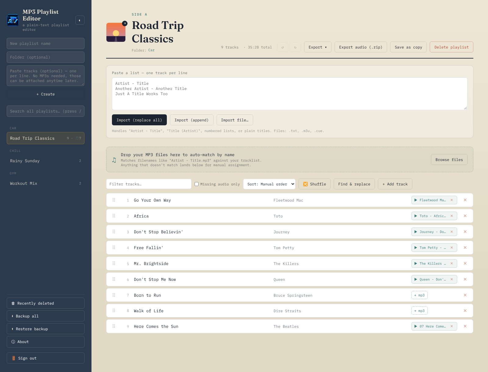

<p align="center">
  
</p>

# MP3 Playlist Editor

A self-hosted web app that turns a pasted tracklist into a numbered, tagged MP3 playlist, run in Docker.


Paste a list of songs and get an editable playlist. Drop your own MP3s on it and they're matched to the tracks by file name and ID3 tags. Then export a `.zip` of the MP3s renamed `0001.mp3`, `0002.mp3`... in playlist order, with your titles, artists and cover art written into the tags: ready for a USB stick, a car stereo or anything that plays files in name order. Everything is stored in one JSON file and a folder of MP3s; there's no account and no outside service.

## ✨ Features

- **Paste to import**: one track per line, as `Artist - Title`, `Title (Artist)`, `1. Artist - Title` or a plain title. Or load a `.txt`, `.m3u`/`.m3u8` or `.cue` file into the paste box to check before importing. Duplicates are skipped.
- **Editing**: edit titles and artists in place (autosaved), drag or `Alt+↑`/`Alt+↓` to reorder, undo and redo, find and replace across titles and artists, shuffle, and sort by title, artist, length or date added.
- **Attach MP3s**: drop a batch on the drop zone to auto-match by file name and ID3 tags, drop one file on a single row, or use "+ mp3". Files that don't match wait in an unassigned list where you pick the track. Blank titles and artists are filled in from the tags, and each track shows its length.
- **Export**: `.txt`, `.m3u`, `.json`, a `.cue` sheet, or the numbered audio `.zip` with a `tracklist.txt`. The MP3s in the zip carry the title and artist from the app and the playlist's cover art.
- **Cover art**: a JPEG or PNG per playlist, embedded as front-cover art on export.
- **Preview player**: plays the playlist in its current order and filter, with previous/next and a waveform you can click to seek.
- **Organising**: several playlists, grouped into folders in the sidebar, search across all of them (press `/`), save as a copy (audio included), and Recently deleted for 7 days.
- **Backup and restore**: one JSON file with every playlist, its tracks, order and folder. Restore merges or replaces.
- **Sign-in**: one shared password, sessions that survive a restart, and a lockout after 10 wrong passwords in 15 minutes.
- **Light and dark themes**, and a health check at `GET /healthz` for Docker, Portainer and uptime monitors.

## 🖼️ Screenshots



## 📋 Requirements

- Docker with Docker Compose v2 (Docker Desktop on Windows, or Docker Engine on Linux or a NAS)
- A modern browser
- To run without Docker: Node.js 22.12 or later

## 📦 Installation

1. Download or clone this repository onto the Docker host.
2. Copy `.env.example` to `.env` and set `APP_PASSWORD` to your own password. See Configuration for the rest.
3. Start it from the repository folder:

   ```
   docker compose up -d
   ```

   This pulls `jason4bury/mp3-playlist-editor` from Docker Hub. To build the image from the source instead, run `docker compose up -d --build`.
4. Open `http://<your-server>:3002` (or the `PORT` you set) and sign in.

**Updating:** `docker compose pull` then `docker compose up -d`. Your playlists and MP3s stay in the data volume or folder.

## 🚀 Usage

1. **Create a playlist** in the sidebar. You can paste the tracks straight into the box underneath, or later into the paste box at the top of the playlist.
2. **Attach your MP3s**: drop them on "Drop your MP3 files here". Anything that doesn't match lands in "Unassigned audio files"; pick the right track from its list.
3. **Tidy up**: edit titles and artists, reorder, and add cover art with "+ cover".
4. **Export audio (.zip)** for the numbered, tagged files. Tracks without audio are skipped, so there are no gaps in the numbering. Export ▾ has the text, playlist and cue sheet formats.

Matching is by name, not by listening, so `Radiohead - Paranoid Android.mp3` or `04 Paranoid Android.mp3` match well and very different names need assigning by hand. Each file can be up to 40 MB. Lengths are exact for constant-bitrate files and close for variable-bitrate ones.

The **Sort** list only changes the view; switch back to "Manual order" to drag. **Shuffle** really reorders and saves. **Undo** covers track edits, adds, deletes and reordering, not attaching or removing audio.

**⬇ Backup all** saves the playlists, not the MP3s, which stay in the data folder. Restoring onto the same data folder keeps the audio and cover art linked; onto a fresh one, the tracks come back without audio. **Replace all** moves your current playlists to Recently deleted first, so it can be undone for 7 days.

**ⓘ About** shows the version, licence and a link to this repository.

## ⚙️ Configuration

All settings live in `.env` next to `docker-compose.yml`. `.env` is gitignored; `.env.example` shows every setting.

| Setting | Required | What it does |
| --- | --- | --- |
| `APP_PASSWORD` | Yes | The sign-in password. The app won't start while it's empty or `changeme` |
| `PORT` | | Port on the host (default `3002`) |
| `MP3_PLAYLIST_EDITOR_TAG` | | Image tag to run: `latest` (default) or a version such as `1.00` |
| `DATA_HOST_DIR` | | Host folder for the data. Blank uses the `mp3-playlist-editor-data` Docker volume |
| `DISABLE_LOGIN` | | `true` runs with no login screen. Only on a network you fully trust |
| `TRUST_PROXY` | | `true` behind a reverse proxy, so the lockout sees real client addresses |

If the app won't start, `docker compose logs mp3-playlist-editor` says which setting is missing.

### Where data is stored

Everything is in the container's `/app/data` folder, which is the `mp3-playlist-editor-data` Docker volume, or `DATA_HOST_DIR` if you set it:

- `playlists.json`: every playlist, its tracks and folder, plus Recently deleted. `playlists.json.bak` is the version before the last save.
- `audio/<playlist id>/`: the attached MP3s, cover art and unassigned files.
- `sessions.json`: signed-in browsers (only hashes of the session tokens).

It survives rebuilds and updates. Back the folder up like any other data; the in-app backup doesn't include the MP3s.

### Putting it on the internet

- Put it behind a reverse proxy with HTTPS (Nginx Proxy Manager, Caddy, Traefik, Synology) rather than forwarding the port from your router, and set `TRUST_PROXY=true`. The session cookie is marked secure when the proxy forwards HTTPS.
- Use a strong `APP_PASSWORD`. It's one shared password, not separate accounts.
- If you only need it yourself, a WireGuard or Tailscale tunnel avoids exposing it at all.

### Running without Docker

Install Node.js 22.12+, run `npm ci --omit=dev`, then start it with `APP_PASSWORD` set, for example in PowerShell:

```
$env:APP_PASSWORD = "your-password"; $env:DATA_DIR = ".\data"; npm start
```

It listens on port 3000 unless `PORT` is set.

### Project layout

```
server.js        Express app: start-up checks, storage, every /api endpoint
auth.js          sign-in, sessions and lockout
mp3-info.js      reads ID3 tags and length, writes tags and cover art on export
version.js       shows package.json's version as v1.00
public/          the browser app (index.html, app.js, style.css, login page, icons)
assets/          icon and README image
docs/            history before v1.00
```

Run `npm run lint` (ESLint) before committing.

## 📝 Changelog

See [CHANGELOG.md](CHANGELOG.md). Changes before v1.00 are in [docs/HISTORY-before-1.00.md](docs/HISTORY-before-1.00.md).

## 📄 Licence

MIT, see [LICENSE](LICENSE). Copyright (c) 2026 Jason Rhodes.
